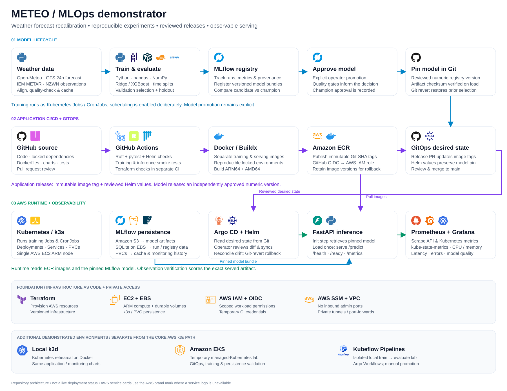

# MLOps Demo

An end-to-end MLOps reference implementation: reproducible experiments, model tracking and approval, containerized inference, Kubernetes workloads, GitOps delivery, infrastructure as code, and observability.

**Weather forecast calibration is the example ML use case.** The repository demonstrates how to take a model from a local experiment to a versioned, monitored service. Its lifecycle and delivery patterns can inform other ML projects; the included data pipeline, features, evaluation rules and API contract remain specific to the weather example.

## Architecture



Training records experiments and registers a validation-selected model in MLflow. An operator approves a champion, and deployment separately pins a numeric model version in Git. CI validates code and containers; optional AWS releases publish immutable images and propose GitOps updates. Argo CD applies reviewed desired state through manual sync.

Application image releases and model promotion are separate decisions. Persistent metadata and artifacts support recovery, and Prometheus/Grafana expose service and infrastructure behavior.

[Editable architecture](docs/diagrams/meteo-mlops-portfolio.drawio) · [PNG](docs/diagrams/meteo-mlops-portfolio.png) · [Simplified view](docs/diagrams/meteo-mlops-light.drawio.svg) · [Diagram scope and sources](docs/diagrams/portfolio-architecture.md)

## What this demonstrates

| Capability | Implementation |
|---|---|
| Reproducible training | Locked Python environment, temporal splits, input hashes, deterministic CPU training and artifact reload checks |
| Experiment tracking | MLflow metrics, parameters, artifacts and model registry |
| Model lifecycle | Validation-based selection, explicit approval, version-pinned serving and rollback |
| Inference | FastAPI, startup artifact validation, health/readiness endpoints and batch input validation |
| Packaging and CI | Non-root Docker images, linting, tests and container smoke checks |
| Delivery | Helm, immutable image tags, release pull requests and manual Argo CD synchronization |
| Infrastructure | Terraform, AWS EC2/k3s, ECR, S3, encrypted EBS and SSM access |
| Observability | Prometheus metrics, Grafana dashboards and workload monitoring |

The core deployment uses a small AWS k3s environment. EKS and Kubeflow Pipelines are separate exercises documented alongside it; neither is required to run the example locally.

## Run the example locally

Requires Python 3.11–3.13 and [uv](https://docs.astral.sh/uv/).

```sh
git clone https://github.com/infraria-labs/mlops-demo.git
cd mlops-demo
uv run --locked meteo-baseline run
```

This installs the locked environment, fetches public weather archives, prepares data, trains and compares candidates, evaluates the selected approach, saves artifacts and verifies reloaded predictions. Internet access is required for the first fetch. Cached archive responses are reused; upstream archives may change, while reproduction against saved input bytes is deterministic.

```sh
# Validate the implementation.
uv run --locked ruff check .
uv run --locked pytest

# Serve the generated model.
MODEL_PATH=artifacts/baseline/model.joblib uv run --locked uvicorn meteo_mlops.api:app --port 8000
```

In another terminal:

```sh
curl -fsS http://127.0.0.1:8000/ready
curl -fsS http://127.0.0.1:8000/predict \
  -H 'Content-Type: application/json' \
  -d '{"forecasts":[{"valid_time":"2026-01-01T12:00:00Z","forecast_c":18.0}]}'
```

Interactive API documentation is available at `http://127.0.0.1:8000/docs`. Start the local MLflow UI with `uv run --locked meteo-tracking server`, then open `http://127.0.0.1:5000`.

## Example ML use case: weather calibration

The model corrects hourly 2 m temperature forecasts for Wellington Airport (NZWN). Inputs pair GFS forecasts at a fixed 24-hour offset with independent station observations. Training learns the residual `observed − forecast` and compares raw forecasts, mean-bias correction, ridge regression and XGBoost using time-based train/validation/test splits.

The recorded held-out comparison contains 4,416 hourly samples from July–December 2025:

| Method | Test RMSE (°C) |
|---|---:|
| Raw forecast | 1.458 |
| Mean-bias correction | 1.200 |
| Ridge regression | 1.118 |
| XGBoost | 1.121 |

Model selection uses validation performance, independently of this test comparison. These results illustrate the example dataset and evaluation procedure; they are not evidence of operational forecast performance for other locations or periods.

[Data provenance and split design](docs/baseline.md) · [Full measured results](docs/results.md) · [Experiment configuration](src/meteo_mlops/config.json)

Generated files live in ignored `artifacts/`, `data/` and MLflow directories. Outputs include metrics, resolved configuration and provenance, predictions, candidate models and a selected `model.joblib`. Only load trusted joblib artifacts: deserialization can execute code.

## Explore the platform

| Area | Guide |
|---|---|
| Learning sequence, operating commands and recovery | [Operations](docs/operations.md) |
| Tracking and model registry | [MLflow](docs/mlflow.md) |
| Training schedules, approval, serving and rollback | [Model lifecycle](docs/retraining.md) |
| Local Kubernetes | [k3d lab](docs/kubernetes-local.md) |
| AWS infrastructure and private access | [AWS k3s](docs/aws-k3s.md) |
| Container CI and Helm | [CI/CD](docs/cicd-helm.md) |
| Reviewed desired state and drift | [GitOps](docs/gitops.md) |
| Metrics and dashboards | [Observability](docs/observability.md) |
| Alternative deployment exercise | [EKS](docs/eks.md) |
| Isolated pipeline experiment | [Kubeflow](docs/kubeflow-local.md) |

## Public snapshot and deployment setup

This repository starts with fresh history and contains sanitized source, tests and documentation. Cloud account identifiers are examples. Credentials, Terraform state/plans, kubeconfigs, datasets, trained artifacts and operational Git history are excluded. Historical validation notes describe the original implementation exercises; they do not assert that this public repository has a running deployment.

Local training and tests require no AWS credentials. The AWS release job is disabled unless the repository variable `ENABLE_AWS_RELEASE` is exactly `true`. To enable it for your own environment, provision your infrastructure, configure the protected `aws-demo` environment and OIDC role, set `AWS_REGION`, `AWS_ROLE_ARN`, `INFERENCE_REPOSITORY` and `TRAINING_REPOSITORY`, and replace example deployment values with your own resources and image/model versions. Review environment protection and branch rules before enabling publishing. Do not reuse example cloud identifiers or assume recorded image tags exist in your registry.

Services are intended for local or private access. An internet-facing service needs its own authentication, TLS and deployment hardening. Cloud exercises create billable resources; follow the documented teardown procedures.

The architecture separates reusable platform concerns from the example model, but adopting another use case requires changes to data ingestion, feature contracts, training, evaluation and inference validation. The existing Python package and CLI retain their `meteo_mlops` / `meteo-*` names.

## License

Source code is available under the [MIT License](LICENSE). Third-party dependencies, external datasets and technology logos retain their respective licenses and terms; see [diagram attribution](docs/diagrams/portfolio-architecture.md).
