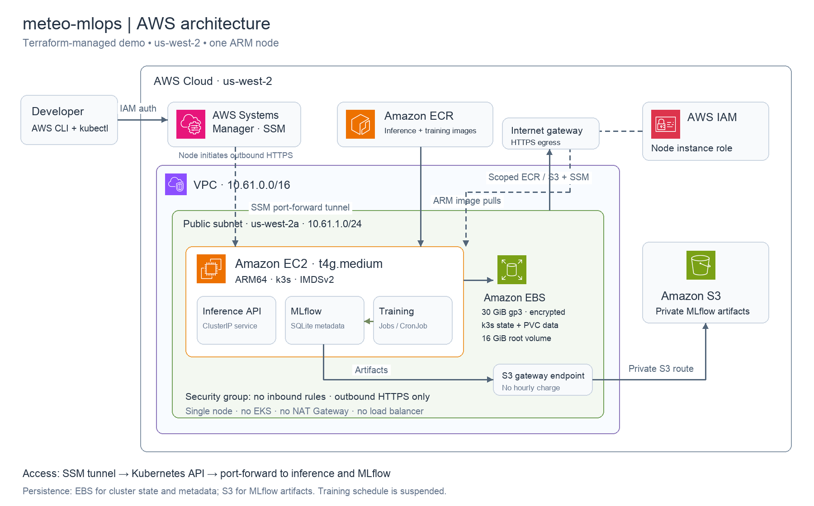

# Low-cost AWS k3s lab

Purpose: provision and administer the AWS node, and learn raw-manifest deployment. The `publish`/`deploy` examples below are the original lab path. Once Helm or Argo owns application workloads, use that owner for releases: [Helm](cicd-helm.md) or [GitOps](gitops.md). Node start/stop/tunnel and manual training helpers still apply. See [operations](operations.md) for the daily workflow.

## Design and scope



Diagram uses [official AWS architecture icons](https://aws.amazon.com/architecture/icons/).

`infra/terraform` manages one `t4g.medium` (2 ARM vCPU, 4 GiB), Amazon Linux 2023, a new VPC with one public subnet/Internet Gateway, no ingress rules, HTTPS egress, a free S3 gateway endpoint, two immutable-tag ECR repositories, a private encrypted/versioned S3 bucket, encrypted 16 GiB root and separate 30 GiB gp3 data EBS, and the node IAM role. There is no EKS, NAT Gateway, load balancer, Elastic IP, paid interface endpoint or managed database. Default region is Oregon (`us-west-2`) for low cost and a small demonstrator; change before first apply if residency/latency matters.

Pinned k3s matches the local lab. `/var/lib/rancher` is mounted from the separate EBS volume **before** k3s starts: SQLite cluster state, the node identity, MLflow SQLite metadata and local-path PVCs live there. Bootstrap waits for the exact EBS NVMe serial, formats only an unformatted device, and fails closed if it cannot mount. A systemd mount dependency applies on every reboot. EBS growth requires an explicit `xfs_growfs /var/lib/rancher` in SSM after Terraform expands the volume; shrinking is unsupported. No high availability or automated backups are claimed.

Kubernetes/API services are private; SSM supplies an authenticated localhost tunnel. The Kubernetes API listens on the node interfaces for internal controllers, but the security group allows no inbound traffic. MLflow/inference remain ClusterIP and are accessed with `kubectl port-forward`. Kubeconfig is cluster-admin: keep it private and never commit or include it in SSM Run Command output/logs. Restrict operator `ssm:StartSession`/`ssm:SendCommand` to the demo node (and required AWS session documents); protect AWS login with MFA. Node role has only SSM core permissions, pulls from these two ECR repositories, and reads/writes `mlflow/*` in this bucket. It cannot push images or delete artifacts. Operator image publication uses separate AWS credentials.

IMDSv2 with hop limit 2 permits MLflow's boto3 inside a pod. This is a **single trust domain**: any workload on this node can potentially assume that same node role, including its SSM permissions. Do not run untrusted/multi-tenant workloads here. Training sends artifacts through the MLflow server; no static AWS access keys are put in Kubernetes. A kubelet exec credential provider uses the AWS CLI and node role to refresh ECR authentication on demand, with one-hour caching. It avoids expiring imagePullSecrets and periodic k3s restarts.

## State and first provisioning

Requires Terraform >=1.10, AWS CLI v2, Session Manager plugin, Docker/buildx, kubectl and uv. This single-operator demo deliberately uses Terraform's local backend and local state locking. `.tfstate`, `.tfvars`, saved plans and `.aws-k3s` are ignored. Store state in an encrypted, backed-up location; losing it prevents reliable teardown. Never run two operators/checkouts against this state. Commit `.terraform.lock.hcl`. For shared operation migrate state to a separately bootstrapped, private/versioned S3 backend with `use_lockfile = true`; keep that state bucket outside this stack's teardown.

```sh
export AWS_PROFILE=YOUR_DEMO_PROFILE
aws sts get-caller-identity  # Verify intended account before planning/applying.
cp infra/terraform/terraform.tfvars.example infra/terraform/terraform.tfvars
terraform -chdir=infra/terraform init
terraform -chdir=infra/terraform fmt -check -recursive
terraform -chdir=infra/terraform validate
terraform -chdir=infra/terraform test  # Mock-provider tests; no AWS resources.
terraform -chdir=infra/terraform plan -out=demo.tfplan
terraform -chdir=infra/terraform apply demo.tfplan
```

Review the saved plan and recurring costs before apply. State contains user data but no AWS keys. AMI selection is the public ARM AL2023 SSM parameter; subsequent AMI drift is ignored to avoid unplanned replacement. The launch-time public-IP flag is also ignored on refresh because AWS reports it false while stopped; this prevents a normal pause from proposing node replacement. The flag is still true on first creation and EC2 reacquires an auto-assigned IP on start. Intentionally upgrade the AMI with a reviewed replacement and backup. Changing user data/k3s version replaces the node; take an EBS snapshot first. The independent data volume reattaches; full node replacement/recovery must be validated separately from reboot. Keep replacements sequential and in the same AZ; the attachment stops the node before detaching EBS. Never force-detach a mounted volume.

## Access and deploy

Wait for the node to appear in `aws ssm describe-instance-information --region us-west-2`. Open an interactive session:

```sh
aws ssm start-session --region us-west-2 --target "$(terraform -chdir=infra/terraform output -raw instance_id)"
# Inside the session:
sudo cloud-init status --wait
sudo systemctl status k3s
sudo mountpoint /var/lib/rancher
sudo k3s kubectl get nodes
sudo cat /etc/rancher/k3s/k3s.yaml
```

After bootstrap succeeds, retrieve it privately with `uv run --locked python scripts/aws-kubeconfig.py` (interactive SSM; credentials are captured only in the local file). Alternatively copy the kubeconfig content into `.aws-k3s/kubeconfig` locally with `umask 077`, `mkdir -p .aws-k3s`, then `chmod 600 .aws-k3s/kubeconfig`. The helper normalizes the server to `https://127.0.0.1:6443`; when copying manually replace `https://0.0.0.0:6443` with that localhost URL and retain the embedded CA/client certificate/key. Close the session. If port 6443 is occupied by a local cluster, stop that cluster first. Run the tunnel in a dedicated terminal:

```sh
scripts/aws-k3s.sh tunnel
```

In another terminal:

```sh
export KUBECONFIG="$PWD/.aws-k3s/kubeconfig"
kubectl get nodes
# Use a new immutable tag for every publication; both repositories receive this image.
scripts/aws-k3s.sh publish git-UNIQUE_COMMIT
uv run --locked meteo-baseline run  # Or use an existing trusted baseline model.
scripts/aws-k3s.sh deploy git-UNIQUE_COMMIT artifacts/baseline/model.joblib
scripts/aws-k3s.sh train
kubectl -n meteo-mlops get pods,jobs,pvc
kubectl -n meteo-mlops port-forward service/mlflow 5000:5000
# Separate terminal if needed:
kubectl -n meteo-mlops port-forward service/inference 8000:8000
```

The renderer reads actual Terraform outputs and adapts the existing local manifests to ECR, S3 and AWS region. It preserves non-root execution, resource bounds, EBS-backed PVCs, checksum-named immutable inference model Secrets and the suspended training CronJob. The Docker image now explicitly includes boto3 for MLflow S3 access and is built for `linux/arm64`. The same image supplies inference, training and MLflow, but separate ECR repositories keep the deployment roles explicit. Publication can be retried after interruption: already published immutable tags are skipped and only missing repository tags are built/pushed. Publishing does not deploy; the provided model remains the inference model until an explicit later deployment. MLflow registration still does not promote aliases automatically.

New AWS runs store artifact bytes in `s3://BUCKET/mlflow` through MLflow's artifact proxy (`mlflow-artifacts:/`); metadata stays in EBS SQLite. Existing local MLflow metadata/artifact URIs are not rewritten by deployment. Keep the local archive intact; recreate runs on the AWS tracking server to establish S3-backed runs. A historical migration preserving run IDs/registry aliases needs a separate backed-up export/import exercise; copying old artifact files into S3 alone does not migrate those metadata references.

## Training, choosing a model and deploying it

Run commands from the repository root. An **image tag** selects the application code and dependencies; a **Run ID/model version** selects the trained model. A new model can use an existing compatible image. Publishing an image, completing training or assigning a registry alias does not update inference automatically.

### 1. Connect to the AWS environment

If the instance was paused, start it and wait for SSM to become available. Keep the Kubernetes tunnel running in terminal A:

```sh
export AWS_PROFILE=default
scripts/aws-k3s.sh start  # Only when the node is stopped.
scripts/aws-k3s.sh tunnel
```

In terminal B, wait for the node and deployments, then keep the MLflow port-forward running:

```sh
export KUBECONFIG="$PWD/.aws-k3s/kubeconfig"
kubectl wait --for=condition=Ready node/meteo-node --timeout=300s
kubectl -n meteo-mlops rollout status deployment/mlflow --timeout=300s
kubectl -n meteo-mlops port-forward service/mlflow 5000:5000
```

Use terminal C for the following commands:

```sh
export AWS_PROFILE=default
export KUBECONFIG="$PWD/.aws-k3s/kubeconfig"
export MLFLOW_TRACKING_URI=http://127.0.0.1:5000
IMAGE_TAG=inf61-20261006-v1  # Existing published demo image; replace when updating code.
```

For new application code, commit the intended changes, set `IMAGE_TAG="git-$(git rev-parse --short HEAD)"`, and run `scripts/aws-k3s.sh publish "$IMAGE_TAG"`. This builds ARM64 and publishes to both ECR repositories. Tags are immutable; a retry skips tags already present. Uncommitted changes do not change the Git hash. Deploy the new tag with the currently approved model before training if the training Job must use the new code: the Job inherits the image and configuration from the deployed CronJob.

### 2. Run training and inspect the result

Create one Job from the deployed training CronJob. The script prints its name; set `JOB` to that exact name:

```sh
scripts/aws-k3s.sh train
JOB=training-REPLACE_WITH_PRINTED_TIMESTAMP
kubectl -n meteo-mlops logs -f "job/$JOB" --pod-running-timeout=300s
kubectl -n meteo-mlops wait --for=condition=complete "job/$JOB" --timeout=1800s
```

The Job downloads archive data, trains/evaluates the configured models and registers the selected bundle in MLflow. Its deadline is 30 minutes. If it fails, inspect `kubectl -n meteo-mlops describe job "$JOB"` and the Job logs before retrying. Run one manual training Job at a time: manual Jobs share the training PVC, and the CronJob's `Forbid` policy does not serialize Jobs created manually.

Open [MLflow](http://localhost:5000), select experiment `meteo/NZWN/gfs_global/temperature_2m/24h`, and find the new FINISHED run. Review validation/test RMSE and skill against the raw forecast, `bundle/evaluation.md`, configuration and data provenance. The training pipeline selects a model using validation RMSE; registration alone does not mean it is approved for deployment. Record the **Run ID** and the corresponding registered version of `nzwn-gfs-temperature-24h`.

### 3. Select and download an approved model

To deploy a specific experiment run, copy its Run ID from MLflow:

```sh
RUN_ID=REPLACE_WITH_FINISHED_RUN_ID
uv run --locked meteo-tracking retrieve \
  "runs:/$RUN_ID/bundle/model.joblib" \
  --output "artifacts/deploy/$RUN_ID"
MODEL_FILE="artifacts/deploy/$RUN_ID/model.joblib"
shasum -a 256 "$MODEL_FILE"
```

Only download and deploy trusted project artifacts: loading joblib executes Python deserialization. The bundle must match the inference application's expected format and dependencies.

Evaluate and explicitly promote the registered version through the lifecycle gate.
Promotion can be rejected even when the run finished successfully:

```sh
VERSION=REPLACE_WITH_REGISTERED_VERSION_NUMBER
uv run --locked meteo-lifecycle evaluate "$VERSION"
uv run --locked meteo-lifecycle promote "$VERSION"
```

To select the current champion instead of manually copying a Run ID, resolve the alias once to its backing run, then use the same download commands above:

```sh
RUN_ID=$(uv run --locked python - <<'PYCODE'
import os
from mlflow import MlflowClient
client = MlflowClient(tracking_uri=os.environ["MLFLOW_TRACKING_URI"])
version = client.get_model_version_by_alias("nzwn-gfs-temperature-24h", "champion")
run = client.get_run(version.run_id)
if run.info.status != "FINISHED":
    raise SystemExit("Champion must reference a FINISHED run")
print(run.info.run_id)
PYCODE
)
```

Resolving once pins the deployment to that run even if someone later moves the alias. Assigning `champion` is a registry operation; it does not itself deploy anything.

### 4. Deploy and verify inference

Before deployment, record the current image, model Secret and readiness response for rollback. Deploy the downloaded file using the chosen published image:

```sh
kubectl -n meteo-mlops get deployment inference -o yaml > /tmp/inference-before-deploy.yaml
scripts/aws-k3s.sh deploy "$IMAGE_TAG" "$MODEL_FILE"
kubectl -n meteo-mlops rollout status deployment/inference --timeout=300s
```

The script creates a checksum-named immutable Secret containing `model.joblib`, mounts it into inference and waits for rollout. It also reapplies the MLflow/training manifests with the same image tag; choose a tag compatible with all three workloads. Kubernetes Secrets have a 1 MiB size limit, so this method is intended for the small demo bundle.

In a separate terminal, keep inference port-forward running:

```sh
export KUBECONFIG="$PWD/.aws-k3s/kubeconfig"
kubectl -n meteo-mlops port-forward service/inference 8000:8000
```

Back in terminal C:

```sh
curl --fail http://127.0.0.1:8000/health
curl --fail http://127.0.0.1:8000/ready
curl --fail -H 'Content-Type: application/json' \
  -d '{"forecasts":[{"valid_time":"2026-01-01T12:00:00Z","forecast_c":18.0}]}' \
  http://127.0.0.1:8000/predict
```

Confirm `/ready` reports `model_version` equal to the full SHA-256 from `shasum`, and that prediction returns finite corrected values. Record the image tag, Run ID, registry version, SHA-256 and verification result together. To restore the previous inference revision:

```sh
kubectl -n meteo-mlops rollout undo deployment/inference
kubectl -n meteo-mlops rollout status deployment/inference --timeout=300s
```

Rollback affects inference only and requires retained Deployment history and its previous model Secret. Verify `/ready` and prediction again. For a reproducible later rollback, redeploy the recorded previous image tag and trusted model file. Moving an MLflow alias back does not roll back Kubernetes.

### Scheduling and automation boundary

The training CronJob is suspended by default. Its configured schedule is Sunday 03:00 UTC. To enable it deliberately:

```sh
kubectl -n meteo-mlops patch cronjob training --type=merge -p '{"spec":{"suspend":false}}'
# Pause scheduled training again:
kubectl -n meteo-mlops patch cronjob training --type=merge -p '{"spec":{"suspend":true}}'
```

The EC2 node must be running at the scheduled time. Subsequent `deploy` commands restore the renderer's default suspended state. Scheduled training still only creates runs and model versions; review, alias assignment and inference deployment remain explicit.

Automatic deployment on a `champion` alias change is a possible next step, requiring a controller/CI job that resolves the alias, downloads the artifact, deploys it, verifies the checksum/readiness and rolls back on failure. **`scripts/aws-k3s.sh deploy-model champion` is not implemented.** Use the procedure above today.

## Live acceptance and evidence

Offline validation does not prove AWS bootstrap, image pulls, S3, reboot or billing. After deploying, run:

```sh
export KUBECONFIG="$PWD/.aws-k3s/kubeconfig"
export KUBE_CONTEXT=default
export AWS_ARTIFACT_DESTINATION="$(terraform -chdir=infra/terraform output -raw artifact_destination)"
uv run --locked python scripts/kubernetes_smoke.py
```

This exercises inference, failed rollout/rollback, a real training Job, MLflow run/metric/artifact retrieval, direct S3 model bytes against the downloaded SHA-256, and metadata/artifact persistence across MLflow pod restart. Training fetches public archive data and can take up to 30 minutes; Standard CPU credits may throttle it. Check `kubectl top` only if metrics-server is ready, and `kubectl describe`/logs for OOM or Pending pods. A 4 GiB node leaves headroom for the requested three workloads, but future monitoring may require `t4g.large`; inspect memory and CPU credits before changing size.

For repeatable instance persistence checks run `uv run --locked python scripts/aws-persistence.py snapshot` after training. It records a FINISHED run ID, model checksum, PVC identities and MLflow model aliases. Reboot with `scripts/aws-k3s.sh reboot`, reconnect the tunnel, wait for node Ready and deployments Available, then run `uv run --locked python scripts/aws-persistence.py verify` to retrieve **that same run** and confirm its model SHA-256/metrics, aliases, PVC identities and inference readiness. Repeat after stop/start. Do not count a newly trained run as reboot persistence proof. Check `findmnt /var/lib/rancher` and `sudo k3s kubectl get pv -o yaml` in SSM: local-path host paths must resolve below the EBS mount. Redeploy the same tag/model and confirm PVC/run IDs remain. Test an uncached ECR pull after >12 hours to prove credential renewal. Save results and measured billing separately before completing the implementation.

Bootstrap troubleshooting: SSM session → `sudo tail -n 100 /var/log/cloud-init-output.log`, `sudo journalctl -u k3s`, and `sudo lsblk -o NAME,SERIAL,FSTYPE,MOUNTPOINT`. If cloud-init failed, fix/review the configuration rather than formatting a populated disk. Confirm outbound HTTPS and node role before debugging ImagePullBackOff. `kubectl logs deployment/mlflow` identifies S3 access errors; check the bucket/prefix and region, without printing IMDS credentials.

## Cost and pause

Planning estimate for Oregon, Linux on demand, 730 running hours/month, excluding tax/credits/free offers:

See the [k3s versus EKS cost comparison](eks.md#k3s-versus-eks-cost-comparison) for matched cost components, equal-worker-size comparison and what “k8s” means.

| Item | Rate assumption | Monthly USD |
| --- | --- | ---: |
| t4g.medium | $0.0336/hour | 24.53 |
| Auto-assigned public IPv4 | $0.005/hour while running | 3.65 |
| gp3 root + data (16 + 30 GiB) | $0.08/GiB-month | 3.68 |
| ECR (example 2 GiB retained across both repositories) | $0.10/GiB-month | 0.20 |
| S3 Standard (example 1 GiB, including versions) | $0.023/GiB-month | 0.02 |
| Approximate base | Small storage/request volumes | **32.08** |

At 40 running hours/month the same assumptions give about **$5.45/month** plus S3 requests, transfer and snapshots. Stopped instances retain both EBS volumes and S3/ECR charges (about $3.90/month under these storage assumptions); auto-assigned IPv4 is released. Standard CPU credits prevent surplus-credit charges but can throttle sustained training. No promise of a hard spending cap: image history, artifacts, snapshots, data transfer and request counts can grow. Untagged ECR layers expire after seven days; tagged images are retained for rollback and must be pruned intentionally. S3 preserves current artifacts and expires noncurrent versions after 30 days.

Verify region-specific assumptions before applying using [EC2 pricing](https://aws.amazon.com/ec2/pricing/on-demand/), [VPC IPv4 pricing](https://aws.amazon.com/vpc/pricing/), [EBS](https://aws.amazon.com/ebs/pricing/), [ECR](https://aws.amazon.com/ecr/pricing/) and [S3](https://aws.amazon.com/s3/pricing/). Estimates are not a measured bill. In Cost Explorer filter by region and activated Project/Environment cost allocation tags; group by SERVICE then USAGE_TYPE. Inspect EC2 running hours, EC2-Other/EBS, VPC IPv4, S3 requests/storage and ECR storage. Billing/tags can lag a day or more. Compare a running day and stopped day; inspect existing account resources separately so unrelated costs are not attributed to this lab.

```sh
scripts/aws-k3s.sh stop
# Wait for instance stopped; later:
scripts/aws-k3s.sh start
# Wait for SSM/node readiness and reconnect tunnel. Public IP may change; SSM uses instance ID.
```

## Full teardown (destructive)

Export needed MLflow data and snapshot EBS first (snapshots continue to cost money). Stop training and port forwards. Use `terraform plan -destroy` to review the deletion set. Defaults intentionally refuse deletion of nonempty S3/ECR stores: empty both ECR repositories and **all S3 versions/delete markers** only after confirming backups and retention intent. `aws s3 rm --recursive` alone does not empty a versioned bucket. Then:

```sh
terraform -chdir=infra/terraform destroy
terraform -chdir=infra/terraform state list  # Must be empty.
```

Destroy deletes the separate EBS data volume as well as root storage, IAM/network and repositories/bucket. Check the AWS console for retained/manual snapshots, buckets, images and other demo resources; remove separately if no longer required. Do not delete local Terraform state until empty-state/remote-resource checks succeed. Remove local kubeconfig afterward. Never use the k3s uninstall script while retaining data: it can remove local-path volume content.
