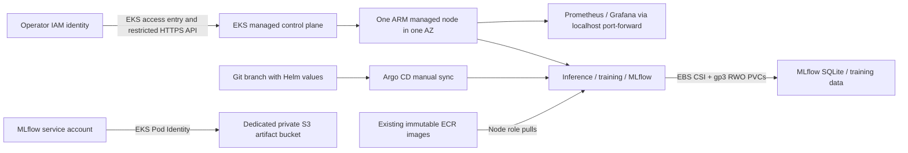

# Temporary Amazon EKS exercise

This is a provision → validate → record → destroy lab. On 2026-10-07 the user requested manual teardown: the validated EKS environment was handed over running, and the user subsequently confirmed all resources were removed and clean. The agent independently confirmed the cluster was absent; complete cleanup is operator-confirmed. `infra/eks` has its own local Terraform state and never manages the existing k3s instance, data disk, S3 bucket or ECR repositories. Keep state, plans, `.tfvars` and `.eks/` private; retain state until teardown has been verified.

## Architecture and scope



Terraform creates a new VPC with two public subnets in distinct AZs (EKS control-plane requirement), Internet Gateway, free S3 gateway endpoint, cluster, access entry, one `t4g.large` ARM node, managed VPC CNI/CoreDNS/kube-proxy/Pod Identity/EBS CSI add-ons, roles and a disposable encrypted S3 bucket. The managed node uses one AZ so replacement nodes can mount the lab's zonal EBS volumes. This is not HA. There is no NAT Gateway, public application Service, load balancer, paid interface endpoint, or autoscaler. Nodes get public IPs for outbound AWS/image/data access; their EKS-managed security group does not permit arbitrary internet ingress. The API public endpoint accepts explicit operator IPv4 `/32` addresses; nodes use the private endpoint.

MLflow alone gets `mlflow/*` S3 read/write permissions through its `mlflow` ServiceAccount and Pod Identity. Training sends artifacts through MLflow. ECR pull authentication belongs to the managed node role; it needs no static imagePullSecret or pod credentials. IMDSv2 hop limit 1 blocks ordinary pod access to node-role credentials; host-network controllers remain privileged. The CNI policy is on the node role for this bounded lab; a production deployment should give `aws-node` its own IAM identity and apply network policies. Kubernetes service-account token automount remains disabled; Pod Identity's agent/webhook injects the separate projected token used by the AWS SDK.

The EBS driver gets its own Pod Identity role. `eks-gp3` uses encrypted gp3, `WaitForFirstConsumer` and `Delete` reclaim. PVCs retain the charts' keep annotations during Helm uninstall; teardown explicitly deletes them while CSI is still operational. S3 `force_destroy` is intentional only for this lab's new bucket: export anything wanted before teardown.

IAM controls AWS APIs and authenticates operators; an EKS access policy grants this single operator cluster administration. Kubernetes RBAC controls controllers and workloads inside the cluster. The application ServiceAccount has no additional Kubernetes RBAC grants. Argo's existing namespace-scoped AppProject allows ServiceAccount resources but no cluster resources; Terraform/explicit operator bootstrap owns CSI and the StorageClass.

## Cost and bounds

Budget a few dollars for a short exercise. The default cost rule is to destroy on the same day; this execution was temporarily retained at the user's explicit request, then manually removed and confirmed clean. Standard-support EKS control plane is $0.10/hour ($2.40/day, about $73/730-hour month); extended support is $0.60/hour and is disabled through `support_type = STANDARD`. Confirm a currently standard-supported Kubernetes version before applying. Node EC2, public IPv4 ($0.005/hour per address), root/PVC EBS, S3 requests/storage and data transfer are additional. AWS Pricing API verified Oregon Linux `t4g.large` on-demand at $0.0672/hour on 2026-10-07. Together with standard EKS and one public IPv4, the base is $0.1722/hour (about $4.13/day), before disks/S3/transfer/CPU credits. Recheck prices for later exercises; this is an estimate, not measured billing. A large rather than medium provides 8 GiB for the application, managed controllers, Argo and monitoring; one-node cap is enforced. Burstable EC2 CPU credits can incur surplus charges under sustained load. Spot is optional and can interrupt training or delay capacity. Scaling the node group to zero does **not** stop the EKS control-plane charge or EBS storage charges. Terraform destroy is the cost stop.

Sources: [EKS pricing](https://aws.amazon.com/eks/pricing/), [public IPv4 pricing](https://aws.amazon.com/vpc/pricing/), [EKS version lifecycle](https://docs.aws.amazon.com/eks/latest/userguide/kubernetes-versions.html), [Pod Identity](https://docs.aws.amazon.com/eks/latest/userguide/pod-id-how-it-works.html), [EBS CSI](https://docs.aws.amazon.com/eks/latest/userguide/ebs-csi.html), [VPC/subnet requirements](https://docs.aws.amazon.com/eks/latest/userguide/network-reqs.html).

## k3s versus EKS cost comparison

Planning estimates verified on **2026-10-08**, in USD for Oregon (`us-west-2`), Linux on demand, **730 running hours/month**, with no tax, discounts or free credits. These compare the repository's k3s defaults with the completed EKS exercise, including monitoring. They are infrastructure estimates, not measured bills or equivalent production availability.

| Cost component | AWS k3s lab | EKS exercise |
| --- | ---: | ---: |
| Kubernetes software licence | $0 | $0 |
| Managed control-plane service | $0; runs on our EC2 host | $73.00/month ($0.10/hour), standard support |
| One worker/control-plane host | t4g.medium, 2 vCPU / 4 GiB: $24.53/month ($0.0336/hour) | t4g.large worker, 2 vCPU / 8 GiB: $49.06/month ($0.0672/hour) |
| One public IPv4 | $3.65/month | $3.65/month |
| gp3 root and application storage | 16 GiB root + 30 GiB data: $3.68/month | 20 GiB root + 2 GiB MLflow + 2 GiB training + 1 GiB Prometheus: $2.00/month |
| NAT Gateway / load balancer / paid interface endpoints | $0; none provisioned | $0; none provisioned |
| **Core infrastructure total** | **$31.86/month** | **$127.71/month** |
| **Equivalent running cost per hour** | **$0.04364** | **$0.17494** |
| **24 running hours** | **$1.05** | **$4.20** |
| Paused, with storage retained | Stop EC2: $3.68/month EBS; S3/ECR still billed | Scale workers to zero: $73/month control plane + $2/month EBS; S3/ECR still billed |

Totals use unrounded rates: `monthly = 730 × (EC2 hourly + IPv4 hourly + EKS hourly) + provisioned gp3 GiB × $0.08`. Daily/hourly figures allocate monthly EBS cost over 730 hours; actual disk billing follows provisioned duration. Extra gp3 IOPS/throughput beyond the included baseline are not provisioned here.

Both columns **exclude** S3 storage/requests, ECR image storage, snapshots, transfer and applicable CPU-credit charges. Shared ECR repositories are billed once, not once per cluster. The existing [k3s estimate](aws-k3s.md#cost-and-pause) is about $32.08/month because it additionally assumes 2 GiB ECR and 1 GiB S3 storage. EKS's earlier $4.13/day figure excludes disks; the $4.20/day figure above includes the 25 GiB of gp3 disks exercised here. The EKS environment has been removed; this table is not a statement of current running resources.

EKS is about **4×** this smaller k3s configuration's core cost, but that comparison also doubles worker memory. With k3s upgraded to the **same t4g.large**, retaining its 46 GiB disks, its estimate is **$56.39/month**; EKS is then about **2.26×**, or **$71.32/month more**. The main difference is the $73 managed control-plane fee, partly offset by EKS's smaller provisioned disk allocation. Neither one-node application deployment is HA; EKS's managed control plane does not make a single worker highly available. Operator time for upgrades, recovery, security and maintenance is not priced in this table.

Rates: [AWS EC2 on-demand pricing](https://aws.amazon.com/ec2/pricing/on-demand/) (Oregon instance prices verified using AWS Pricing API), [EKS control-plane pricing](https://aws.amazon.com/eks/pricing/), [public IPv4 pricing](https://aws.amazon.com/vpc/pricing/), and [EBS gp3 pricing](https://aws.amazon.com/ebs/pricing/) (Oregon storage price verified using AWS Pricing API).

### What about “k8s”?

**K8s is an abbreviation for Kubernetes**, not another hosting service. Kubernetes is the common orchestration platform underneath both setups: Pods, Deployments, Services, PVCs, Jobs, RBAC and the Kubernetes API. [K3s is a Kubernetes distribution](https://docs.k3s.io/) that packages the platform and useful defaults for a smaller installation. [EKS is AWS-managed Kubernetes](https://aws.amazon.com/eks/pricing/): AWS runs the control plane, while our managed node group runs the application. This is why the same Helm application works in both.

| Meaning of the option | Software fee | Infrastructure and operational costs |
| --- | --- | --- |
| k3s on EC2 | $0 | EC2 runs control plane and workloads; we maintain the cluster, OS and recovery |
| EKS | $0 for Kubernetes itself | EKS service fee plus workers/storage/networking; AWS operates the control plane, we maintain application configuration and worker/add-on lifecycle |
| Self-managed upstream Kubernetes, e.g. kubeadm on EC2 | $0 | Pay for all control-plane and worker hosts, storage and networking; we assemble and operate runtime, CNI, CSI, certificates, etcd backup/recovery and upgrades |
| Local Kubernetes, e.g. our k3d lab | No AWS cluster fee | Uses existing computer resources; hardware, electricity and maintenance still have costs |

There is no universal “k8s monthly price.” A single-host upstream Kubernetes lab can have infrastructure costs similar to k3s if it fits the same host. A deployment with separate control-plane hosts adds their EC2/disk/IP costs; a typical HA control plane uses three hosts, with workload capacity budgeted separately. It avoids the EKS service fee but increases operational responsibility. Kubernetes software being open source does not make its hosting or operation free. See the [Kubernetes overview](https://kubernetes.io/docs/concepts/overview/) and [kubeadm HA topology guide](https://kubernetes.io/docs/setup/production-environment/tools/kubeadm/ha-topology/).

## Provision

Prerequisites: AWS CLI v2 with valid demo-account permissions for EKS/EC2/IAM/S3, Terraform >=1.10, kubectl compatible with the selected Kubernetes version, Helm, Python project environment, outbound HTTPS, existing immutable ARM ECR images and a trusted local `model.joblib`. `aws sts get-caller-identity` must show the intended account. No Docker build is needed when reusing existing images.

```bash
export AWS_PROFILE=default
export AWS_REGION=us-west-2
aws sts get-caller-identity
aws eks describe-cluster-versions --region "$AWS_REGION" \
  --query 'clusterVersions[?versionStatus==`STANDARD_SUPPORT`].[clusterVersion,endOfStandardSupportDate]'
cp infra/eks/terraform.tfvars.example infra/eks/terraform.tfvars
# Edit operator_arn to an IAM role/user ARN (not an STS assumed-role session ARN).
# Edit operator_cidrs to your current public IPv4 /32 and choose a supported version.
terraform -chdir=infra/eks init
terraform -chdir=infra/eks fmt -check
terraform -chdir=infra/eks validate
terraform -chdir=infra/eks test
terraform -chdir=infra/eks plan -out=exercise.tfplan
# Review: only the dedicated exercise resources, one node, no existing k3s changes.
terraform -chdir=infra/eks apply exercise.tfplan
scripts/eks.sh kubeconfig
# If the system kubectl is outside +/- one minor version, select a matching client.
export KUBECONFIG="$PWD/.eks/kubeconfig"
export KUBE_CONTEXT="eks-$(terraform -chdir=infra/eks output -raw cluster_name)"
kubectl --context "$KUBE_CONTEXT" get nodes
```

A ready node and ACTIVE add-ons establish infrastructure readiness; they do not prove application acceptance. Add-on versions are discovered for the selected Kubernetes version and fixed into the reviewed saved plan/state; record `terraform output -json addon_versions` in the evidence. A later fresh plan can choose newer compatible versions.

## Deploy and validate

Review `gitops/eks/values.yaml` for the real account, immutable ARM image tags, dedicated S3 destination and independent model checksum reference. Never use `latest` or poll registry aliases. The helper derives region/bucket/model reference from this Terraform state and the supplied model; update committed desired state to those same values before Argo sync.

```bash
scripts/eks.sh deploy artifacts/baseline/model.joblib
scripts/eks.sh monitoring
scripts/eks.sh status
export AWS_ARTIFACT_DESTINATION="$(terraform -chdir=infra/eks output -raw artifact_destination)"
# Exercises prediction, a deliberately failed image rollout/rollback, training,
# S3 artifact checksum and MLflow SQLite persistence across pod restart.
uv run --locked python scripts/kubernetes_smoke.py
```

Training downloads the same NZWN/GFS input data as the k3s lab. The source, dates, fields and split rules remain in [baseline.md](baseline.md); the runtime image and independently chosen inference model are recorded separately. Training completion does not promote or deploy its output. To deploy a new trusted artifact, retrieve its immutable numeric registry version/run artifact, then call `scripts/eks.sh deploy MODEL_FILE` and update the checksum reference in Git.

Verify identity inside MLflow without printing tokens or credential bytes:

```bash
kubectl --context "$KUBE_CONTEXT" -n meteo-mlops exec deployment/mlflow -- \
  python -c 'import boto3; print(boto3.client("sts").get_caller_identity()["Arn"])'
# Expected assumed role: meteo-mlops-eks-exercise-mlflow, not the node role.
kubectl --context "$KUBE_CONTEXT" get pods -n kube-system -o wide
kubectl --context "$KUBE_CONTEXT" get pv
```

For GitOps, push the reviewed branch containing the EKS chart/values first, and ensure `gitops/eks/application.yaml` points at that branch (or a merged immutable revision). Install the existing pinned Argo controller on the **EKS** kubeconfig, configure read-only repository access using `scripts/argocd-repository.sh`, and register the application:

```bash
scripts/argocd-bootstrap.sh
# Private repo: use a repository-scoped read-only token file or GitHub App;
# see docs/gitops.md. Never copy an existing cluster's Secrets into logs.
scripts/argocd-repository.sh token /absolute/private/path/contents-read-token
kubectl --context "$KUBE_CONTEXT" apply -f gitops/argocd/project.yaml
kubectl --context "$KUBE_CONTEXT" apply -f gitops/eks/application.yaml
uv run --locked python scripts/argocd-demo.py status
uv run --locked python scripts/argocd-demo.py sync
uv run --locked python scripts/argocd-demo.py drift
```

Manual sync must end Synced/Healthy; the drift exercise must observe OutOfSync and restore Git. Existing CI updates `gitops/aws/values.yaml` for k3s; EKS is deliberately operator-managed and does not redirect that release pipeline.

In separate terminals, use the explicit context for private monitoring:

```bash
kubectl --context "$KUBE_CONTEXT" -n meteo-mlops port-forward --address 127.0.0.1 service/monitoring-prometheus 9090:9090
kubectl --context "$KUBE_CONTEXT" -n meteo-mlops port-forward --address 127.0.0.1 service/monitoring-grafana 3000:3000
uv run --locked python scripts/monitoring_smoke.py --kubeconfig "$KUBECONFIG" --context "$KUBE_CONTEXT"
```

Capture node/add-on state, Argo sync/health, training metrics/model SHA, S3 round-trip/pod-restart evidence, monitoring target health and dashboard screenshots before teardown. Never capture kubeconfig, Secrets, tokens or passwords.

## Troubleshooting

* API timeout: check current public IP against `operator_cidrs`; plan/apply the new `/32`. Verify `.eks/kubeconfig` and `KUBE_CONTEXT`, not `.aws-k3s` or OrbStack.
* Node not Ready: inspect EKS node-group health, route/public-IP assignment and IAM policies. ARM node groups require ARM images.
* PVC Pending: `WaitForFirstConsumer` waits for a scheduled consuming pod. Inspect CSI add-on health, Pod Identity agent, role association and pod events. Cross-AZ EBS attach cannot work; this lab pins nodes to one AZ.
* S3 AccessDenied: check the MLflow ServiceAccount name, Pod Identity association, agent and bucket/prefix. `boto3` must support container credentials. No static-key fallback.
* Argo ComparisonError: branch must be pushed and readable; review repo connection and Application conditions. Register the namespace ServiceAccount kind in AppProject. Cluster-scoped StorageClass stays operator-managed.
* Monitoring scrape failure: inspect cAdvisor permissions/connectivity and EKS-managed node TLS endpoints; successful Helm install alone does not prove scraping.

## Operator access during an exercise

The 2026-10-07 execution was handed over running and subsequently removed by the user. The following access commands apply only while a freshly provisioned exercise exists:

```bash
export AWS_PROFILE=default
export AWS_REGION=us-west-2
export PATH="$PWD/.eks/bin:$PATH" # matching kubectl v1.35.9 was checksum-verified for this run
export KUBECONFIG="$PWD/.eks/kubeconfig"
export KUBE_CONTEXT=eks-meteo-mlops-eks-exercise
scripts/eks.sh status
```

During the exercise, the App/key was stored in the EKS repository Secret; the existing k3s credential was not changed. Local validation port-forwards can be reopened using the explicit context. Terraform state, dedicated kubeconfig and cleanup inventory remain ignored/private in this checkout. Keep the review branch available while the Argo Application targets it; after merging, deliberately change its revision if desired. Do not delete local state before completing teardown.

## Teardown and verification

Export wanted MLflow runs/artifacts and evidence first. Stop port-forwards. This removes only the new EKS environment; existing k3s resources and shared ECR images remain. Do not destroy CSI/IAM before PVCs have finished deletion.

```bash
uv run --locked python scripts/eks_cleanup.py capture # exact node/root/CSI IDs before PVC deletion
scripts/eks.sh clean-workloads
mkdir -p .eks
terraform -chdir=infra/eks output -json > .eks/outputs-before-destroy.json
terraform -chdir=infra/eks plan -destroy -out=destroy.tfplan
terraform -chdir=infra/eks apply destroy.tfplan
terraform -chdir=infra/eks state list # must be empty
uv run --locked python scripts/eks_cleanup.py verify # exact IDs, ASG, roles, bucket, VPC, snapshots
aws eks list-clusters --region "$AWS_REGION"
# Check recorded VPC ID for orphan ENIs, EBS CSI volumes/snapshots,
# managed-node EC2/ASG/root disks, public IPs, dedicated S3 bucket and IAM roles.
# ResourceNotFound/NoSuchBucket is success only for the recorded exercise resource.
```

CSI-created disks are outside Terraform state: an empty state alone is insufficient. The verification helper checks recorded root/CSI volumes and instance IDs, ASGs, snapshots, bucket, roles and VPC; it fails on API access errors rather than treating them as deletion. For additional manual inventory, query EC2 volumes tagged `kubernetes.io/cluster/meteo-mlops-eks-exercise=owned`, EC2 instances with `Environment=eks-exercise`, network interfaces/security groups in the recorded VPC, and the exact bucket/role names. Verify zero surviving billable resources. If namespace deletion stalls, inspect finalizers/events while CSI remains alive; do not strip finalizers to hide a failed disk deletion. If Terraform destroy fails, retain state, fix the specific dependency and rerun. The existing k3s instance/EBS/S3/ECR remain billable under their own lifecycle. Cost Explorer may lag; record expected cost separately from later observed billing.

## k3s versus EKS

| Area | Existing AWS k3s lab | Temporary EKS lab |
|---|---|---|
| Control plane | Operator owns k3s on one EC2 host | AWS operates control plane; separate hourly charge and version support policy |
| Operator access | SSM tunnel / local kubeconfig | AWS IAM auth, EKS access entry/policy, restricted API endpoint |
| Pod AWS identity | Shared node IMDS role / trust domain | MLflow and CSI have separate Pod Identity roles |
| Networking | k3s overlay, SSM-only host access | VPC CNI assigns pod VPC IPs; subnet/ENI capacity and public/private endpoints matter |
| Persistent storage | local-path directories on one data EBS | CSI dynamically provisions encrypted zonal gp3; PVC/PV reclaim matters |
| ECR | k3s credential-provider configuration | Managed node role and kubelet integration |
| Upgrades | k3s/OS operated manually | Managed add-on/node/control-plane versions must remain compatible |
| Availability | Single host | Managed control plane, but this one-node/AZ workload is still not HA |
| Cleanup | EC2/data EBS and artifacts follow explicit retention | Delete PVCs while CSI runs, then Terraform; verify unmanaged disks are gone |

AWS Load Balancer Controller is unnecessary because every application/UI remains ClusterIP. Karpenter/cluster autoscaling is unnecessary for a one-node capped exercise. Production improvements (private nodes, isolated CNI identity, restricted operator roles, network policies, HA nodes and external MLflow database) are separate work, not claims about this lab.

## Recorded execution

Live validation results and teardown verification are recorded in [eks-validation.md](eks-validation.md).
