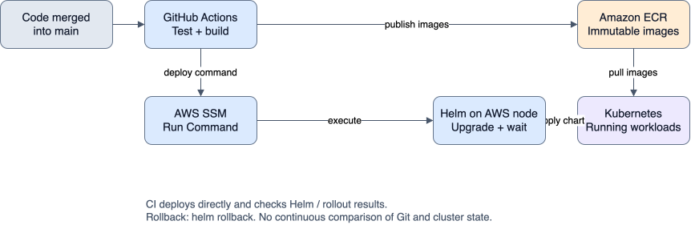
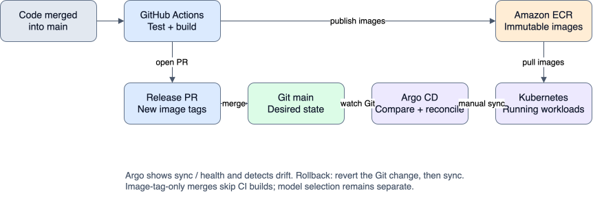

# GitOps with Argo CD

Purpose: make Git the application deployment source of truth. Prerequisites: the existing AWS workloads, repository credentials and reviewed desired state. Installation alone does not establish adoption; verify repository access and a successful sync before switching deployment ownership. See [operations](operations.md) for routine release commands.

CI tests and builds images, publishes both immutable full-SHA ECR tags, then opens
an image-release PR. Git holds the Helm chart and `gitops/aws/values.yaml`; Argo CD
reads them and applies the reviewed desired state. CI has no kubeconfig, SSM
deployment command or Helm upgrade step. Model selection stays independent:
`modelSecret`, `inference.registryVersion` and `inference.qualityConfigMap` are
explicit Git choices, preserved by image-release automation. Secret bytes, model
files, MLflow metadata and credentials do not belong in Git.

## Workflow

### Before Argo CD: direct CI deployment



CI invokes SSM Run Command to run Helm on the AWS node, then waits for the
upgrade and Deployment rollouts. Rollback uses `helm rollback`; there is no
continuous Git-to-cluster drift comparison.

[Editable draw.io source](diagrams/meteo-mlops-cicd-before-argo.drawio).

### With Argo CD: GitOps deployment



Argo detects drift and shows sync/health status. To roll back, revert the Git
desired-state change, then sync. Image-tag-only merges skip CI builds to avoid
another release loop; model selection remains separate.

The [editable draw.io diagram](diagrams/meteo-mlops-cicd.drawio) represents the
same workflow.

### Benefits and tradeoffs

| Approach | Pros | Cons |
| --- | --- | --- |
| Direct CI deployment | Fewer components to install and maintain. One pipeline builds and deploys, with immediate Helm/rollout feedback. Convenient for a small demo. | CI needs deployment permissions and cluster access through SSM. Manual changes can persist unnoticed between deployments. Deployment visibility depends on pipeline logs, and Helm rollback does not update Git's desired state. |
| Argo CD / GitOps | Image and configuration changes are reviewed and recorded in Git. Argo shows live sync/health status and detects drift. CI only publishes artifacts and proposes desired-state changes. A Git revert records rollback intent. | Adds controllers, resource usage, repository credentials and another system to maintain. Release PR merge and manual sync add steps. CI success does not mean deployment success; operators must check Argo. Secrets and persistent data still need separate management. |

For this demo, direct CI deployment is simpler to operate. Argo CD adds a
durable deployment record and ongoing visibility into differences between Git
and the cluster. With the current manual sync policy, Argo detects drift but
only corrects it when an operator syncs; automatic correction requires self-heal.
Neither approach restores database or model-artifact contents during an
application rollback.

## the implementation: install and register

This demo uses the existing AWS k3s node, not the default workstation context.
Keep `scripts/aws-k3s.sh tunnel` running in a separate terminal. From the repo root:

```sh
export KUBECONFIG="$PWD/.aws-k3s/kubeconfig"
kubectl get nodes
kubectl -n meteo-mlops get deployments,pvc
scripts/argocd-bootstrap.sh
scripts/argocd-repository.sh app APP_ID INSTALLATION_ID /absolute/path/to/app-private-key.pem
```

The installer pins Argo CD v3.5.4 using the official non-HA manifest. This adds
controllers, Redis and the repository server to the existing single-node demo;
check `kubectl top nodes`/`kubectl top pods -n argocd` for memory pressure. There is
no new EC2 instance, load balancer, ingress or public UI. UI access uses TLS/login
on a localhost port-forward. The repository script uses a GitHub App installed only on
`infraria-labs/mlops-demo`, with repository **Contents: read** (Metadata: read is
implicit). GitHub policy disables deploy keys here. The App private key stays
in your local PEM file and the Argo repository Secret; temporary manifests have
restrictive permissions and are removed on exit. HTTPS fits the existing node
egress rules. Rotate the App key and re-run the command before revoking the old
key. Do not use the workstation's broad `gh` token.

If the App does not exist: open the organization's Settings → Developer settings
→ GitHub Apps → New GitHub App, choose a unique name such as
`infraria-meteo-argocd`, homepage `https://github.com/infraria-labs/mlops-demo`,
disable webhook Active, grant only Contents: read, and select installation only
on this account. Create the App, record its App ID, generate/download a private
key, then Install App → Only select repositories → meteo-mlops. The installation
ID is the number in the installation settings URL. Feed those IDs and the local
PEM path to the script; never paste the private key into chat or Git.

A repository-scoped fine-grained Contents-read token is also supported with
`scripts/argocd-repository.sh token /absolute/path/to/token-file`; use an expiring
token and arrange rotation. The chosen demo setup uses a GitHub App.

Before adoption, back up MLflow SQLite state, record model/verification references
and compare the current images/configuration with `gitops/aws/values.yaml`.
The checked-in initial values preserve the observed AWS image SHA, model and
verification mount. Recheck them if the live installation has changed.
The namespace, model Secret and verification ConfigMap must already exist.
They remain outside Argo ownership; the AppProject excludes Secret/Namespace
management. PVCs have `Prune=false,Delete=false`; deletion of the namespace or
manual PVC deletion still destroys state. Never uninstall the old Helm release
to migrate: Argo adopts the same resource names in place. Helm history becomes
historical; stop Helm/raw-manifest deployment once Argo owns the application.

After these files are available on main:

```sh
kubectl apply -f gitops/argocd/project.yaml
kubectl apply -f gitops/argocd/application.yaml
python3 scripts/argocd-demo.py refresh
python3 scripts/argocd-demo.py status
```

Initial `OutOfSync` is expected until the first manual sync. Review the UI diff,
including images, model reference, verification mount and PVC names, then run:

```sh
python3 scripts/argocd-demo.py sync
kubectl -n meteo-mlops get deployments,pods,pvc
```

The storage initialization Job is an Argo **Sync** hook: it binds training storage
during the sync (before health waits), is recreated safely for each sync and is
deleted by Argo after success. Kubernetes TTL is disabled for this hook so Argo
can observe completion. The original Helm lab behavior is retained by default.

Manual sync is deliberate initially. Git changes and live drift appear as
`OutOfSync`; an operator reviews and applies them. To enable automatic sync later,
edit the Application in Git, adding `automated: {prune: false, selfHeal: true}`
under `syncPolicy`, then apply that registration. Bootstrap/project/Application
registration is operator-managed; the application does not manage itself.

## Private UI and CLI workflow

```sh
kubectl -n argocd port-forward --address 127.0.0.1 service/argocd-server 8080:443
```

Open `https://localhost:8080`, accept the demo's self-signed certificate, and log
in as `admin`. Retrieve the initial password in your own terminal:

```sh
kubectl -n argocd get secret argocd-initial-admin-secret \
  -o jsonpath='{.data.password}' | base64 --decode
```

Change the password in User Info and delete the initial-admin Secret after
confirming the new login. Do not disable authentication or TLS. The UI shows
Sync, Health, resource differences, operation results and Git revision.
Optional matching Argo CLI commands (install separately):

```sh
argocd login localhost:8080 --username admin --insecure
argocd app get meteo-mlops --hard-refresh
argocd app diff meteo-mlops
argocd app sync meteo-mlops
argocd app wait meteo-mlops --sync --health --timeout 600
```

`--insecure` here accepts only the local self-signed UI certificate. Repository
HTTPS repository certificate verification remains enabled. The included Python helper offers status,
refresh and manual sync using the explicit kubeconfig without installing a CLI.
If a sync fails, inspect Application conditions, operationState, pod events and
controller/repository logs before retrying. Successful CI publication is not
proof of a healthy Argo deployment.

## the implementation: image-release PRs

The release job keeps the protected `aws-demo` OIDC environment and ECR publishing
permissions. Terraform removes CI's SSM Run Command grants. Apply the reviewed
Terraform policy change after the controller reconciles successfully. The node's
SSM operator access remains available for administration. Remove obsolete GitHub
environment variables `INSTANCE_ID` and `ARTIFACT_DESTINATION`; retain
`AWS_ROLE_ARN`, `AWS_REGION`, `INFERENCE_REPOSITORY` and `TRAINING_REPOSITORY`.
Repository/image URLs in desired state must match those publication variables.

Enable **Allow GitHub Actions to create and approve pull requests** under the
repository's Actions → General settings (the workflow creates PRs, never approves
them). It requests `contents: write` and `pull-requests: write` only in the release
job. Every successful main source build creates/reuses `gitops/release-SHA` with
commit `release(app): images SHA; preserve selected model`. It changes only the
two tags and leaves every other desired-state byte intact. Review/merge one
current release PR at a time; close stale PRs instead of deploying older builds.
PR merge conflicts protect concurrent edits; never resolve by discarding model
or configuration changes. Retries reuse immutable images and the existing branch.

GitHub does not trigger workflows for PRs created using `GITHUB_TOKEN`. If required
checks are configured, trigger checks by a human-authorized branch update or use
a dedicated GitHub App installation token for PR creation. Do not bypass branch
protection. Desired-state-only main commits are excluded from automatic image
builds to avoid an endless release loop. Pull-request validation still covers
human-triggered desired-state changes. `workflow_dispatch` can explicitly rerun
the pipeline when needed.

After merging the release PR, refresh Argo, review its diff and sync. Confirm
`Synced/Healthy`, pod image tags, `/ready` and a prediction. `release(model): ...`
commits should separately identify the selected registry version or immutable
model Secret and matching verification ConfigMap. Provision those external
objects before syncing their references. Training and alias promotion never
implicitly rewrite serving desired state.

## the implementation: drift and rollback

Start from `Synced/Healthy`, with automated self-heal off:

```sh
python3 scripts/argocd-demo.py drift
```

This changes only the live runtime ConfigMap's `MPLCONFIGDIR`, forces a comparison,
requires observed `OutOfSync`, syncs the Git revision, checks the original field
was restored and waits for `Synced/Healthy`. Failure restores that one field.
The app's source and Git values are untouched by the drift test.

For rollback, record the current image SHA and model identity. Merge a release
PR pointing at a second pair of already-published immutable ECR images; refresh,
review, sync and check health. Then revert that desired-state commit through Git:

```sh
git switch -c rollback-app origin/main
git revert IMAGE_RELEASE_COMMIT
git push -u origin rollback-app
gh pr create --base main --title 'release(app): revert image release' --body 'Restore the previous Git image tags.'
```

After review/merge, refresh and sync again. Verify both Deployment images and
the CronJob image equal the recorded previous values, `Synced/Healthy`, `/ready`
and a prediction. Do not use `helm rollback`, `kubectl set image` or Argo history
rollback as the durable recovery path: the Git revert is the source of truth.
Reverting configuration works the same way. This restores app/config/model
references, not MLflow database changes, S3 artifacts or training output. Keep
the referenced immutable images and model objects available for rollback.

For pre-merge acceptance, use the implementation branch in `targetRevision` and
perform release/revert commits there, then restore the original desired state.
After merge, patch the live Application back to `main` and verify it is healthy.
Never leave the live target pinned to a deleted branch.

## Pause and teardown

Manual mode already pauses reconciliation until sync is requested. Keep the AWS
stop/start and cost controls in [the AWS runbook](aws-k3s.md). Controller downtime
does not stop running workloads. Deleting this Application (no cascade finalizer)
only unregisters it; workloads/PVCs persist. Uninstall the GitHub App repository access and
remove its Secret when retiring GitOps. To remove Argo itself, first unregister
the Application, then delete the pinned install manifest's resources and namespace.
Do not delete the meteo-mlops namespace/PVCs unless intentionally destroying data.

References: [Argo installation/access](https://argo-cd.readthedocs.io/en/stable/getting_started/),
[sync options](https://argo-cd.readthedocs.io/en/stable/user-guide/sync-options/),
[resource hooks](https://argo-cd.readthedocs.io/en/stable/user-guide/resource_hooks/),
[GitHub token workflow behavior](https://docs.github.com/en/actions/how-tos/writing-workflows/choosing-when-your-workflow-runs/triggering-a-workflow).

## Acceptance record (2026-10-07)

Local verification: Ruff, 66 pytest checks (including real Helm rendering), shell
syntax, Terraform validation and three mocked Terraform tests passed. Argo CD
v3.5.4 was installed on the existing AWS node; all seven controller/support pods
were Ready. At inspection the node used 63% memory (2414 MiB). The Application
and restricted AppProject are registered in manual mode against the review branch.
GitHub rejected deploy keys because repository policy disables them; a read-only
GitHub App was selected instead. Until its credential is installed, the Application
reports `ComparisonError` / sync `Unknown` and has not adopted the workloads.
Live drift and Git-revert rollback are unverified. Existing workloads remain Ready.
The live CI IAM policy and main workflow remain at the previous deployment stage
until successful GitOps adoption and merge/cutover; do not declare the implementation or its
subissues complete from installation/local tests alone.
