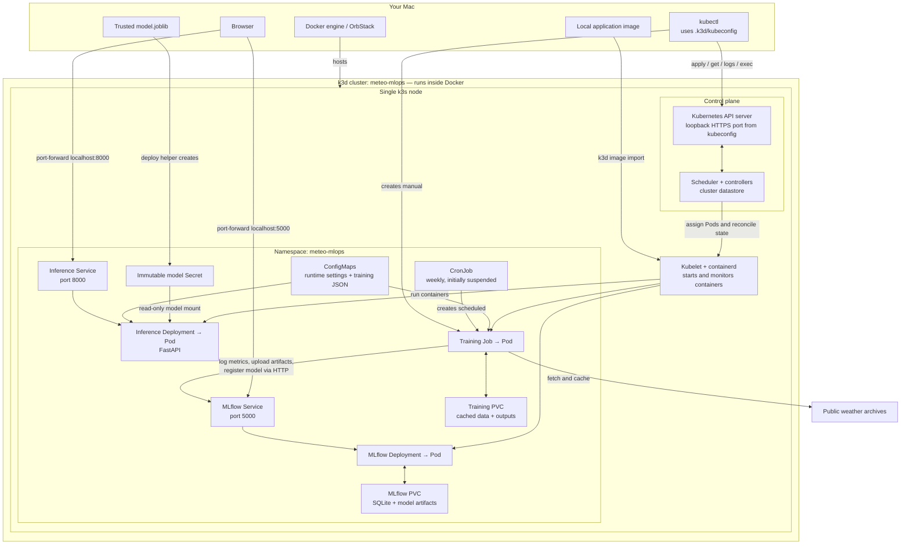

# Local Kubernetes with k3d

Purpose: learn Kubernetes using disposable local raw manifests. Prerequisites: Docker, k3d, kubectl and a trusted model. Once Helm owns the workloads, use [the Helm guide](cicd-helm.md) instead of the raw deploy helper. See [operations](operations.md) for routine checks.

This lab uses plain manifests, one k3s node and the existing locked Python image. Requires a running Docker-compatible engine, k3d 5.9 and kubectl compatible with Kubernetes 1.33. On macOS: `brew install k3d kubernetes-cli`. Allow approximately 4 GB RAM and disk space for images, training and volumes.

## Architecture



The arrows show logical relationships. `kubectl port-forward service/...` selects a backing Pod and tunnels traffic through the Kubernetes API; browser traffic does not enter through the Service's ClusterIP directly.

There are two main flows:

- **Management:** `kubectl` sends instructions to the control plane. The API server receives requests; the scheduler chooses nodes for new Pods; controllers reconcile desired and actual state; the datastore retains cluster configuration. The node's kubelet starts and monitors containers using containerd. In this single-node lab, the control plane and application Pods share the same node. ConfigMaps, Secrets, probes and resource limits describe how those Pods run.
- **Application traffic:** Services route requests to ready Pods. Inference loads its mounted model once at startup. Training downloads weather data, fits models and sends results to MLflow through its Service.

**Training does not automatically update inference.** Review a trained model, retrieve its artifact and explicitly deploy it. The model Secret's checksum-based name lets a Deployment rollback restore the previous model.

PVCs survive Pod replacement, but their storage lives inside the local k3d node. **Deleting the cluster deletes that storage.**

OrbStack hosts the Docker containers here. Its separate Kubernetes cluster has its own context; select `.k3d/kubeconfig` in each terminal used for this lab. Entering the repository or changing Git branches does not select a Kubernetes cluster.

The control-plane URL is an API endpoint, not a browser dashboard. Its certificate is signed by the cluster's own CA, which the kubeconfig supplies to kubectl along with a client certificate. Use the port-forwarded application URLs for browser access. The API port can change when the cluster is recreated; inspect it with `kubectl config view --minify` after selecting the lab kubeconfig.

## Create, deploy, train, destroy

From the repository root:

```sh
scripts/k3d-local.sh create
export KUBECONFIG="$PWD/.k3d/kubeconfig"
# Generate a trusted artifact if none exists:
uv run --locked meteo-baseline run
scripts/k3d-local.sh deploy artifacts/baseline/model.joblib
scripts/k3d-local.sh train
kubectl -n meteo-mlops get jobs
# Substitute the generated Job name:
kubectl -n meteo-mlops logs -f job/training-REPLACE
kubectl -n meteo-mlops wait --for=condition=complete job/training-REPLACE --timeout=1800s
```

The kubeconfig is isolated from your default context. Use it for all commands below. The cluster config pins k3s and binds its API to loopback. `deploy` builds `meteo-inference:k3d-v1` and imports it into k3d's containerd; host Docker images are not automatically visible to Kubernetes. `imagePullPolicy: Never` prevents accidental registry fallback. For code rollouts, build/import a **new tag**, edit the manifest image, and apply it; retain previous tags for rollback. Rebuilding the same tag does not trigger a rollout.

```sh
kubectl -n meteo-mlops port-forward --address 127.0.0.1 service/inference 8000:8000
# Another terminal:
curl -fsS http://127.0.0.1:8000/health
curl -fsS http://127.0.0.1:8000/ready
curl -fsS http://127.0.0.1:8000/predict -H 'Content-Type: application/json' \
  -d '{"forecasts":[{"valid_time":"2026-01-01T12:00:00Z","forecast_c":18.0}]}'
# A separate terminal:
kubectl -n meteo-mlops port-forward --address 127.0.0.1 service/mlflow 5000:5000
```

Open http://127.0.0.1:5000 to inspect runs, metrics, artifacts and registry versions. Training connects using Service DNS `http://mlflow:5000`. MLflow proxies artifacts to its PVC through `mlflow-artifacts:/`; clients need no shared artifact filesystem. SQLite and artifacts share `mlflow-data`. A single server worker and `Recreate` deployment prevent overlapping SQLite servers. This lab is unauthenticated and intended for local use.

## Explicit primitives

- Namespace groups the lab's resources; Services provide stable DNS and ClusterIP access.
- ConfigMaps supply runtime settings and the full training JSON. Edit `training-config` in `config.yaml` for experiments; new Jobs consume the updated configuration.
- The deploy script creates an immutable, checksum-named Secret containing the trusted inference artifact and renders its name into the Deployment. This small baseline model fits Kubernetes' 1 MiB Secret limit. Secrets are encoded, not encrypted by default; do not commit generated Secret manifests. Large models need an artifact download or volume approach. No fake credentials are introduced for an unauthenticated local server.
- Separate `local-path` PVCs store MLflow state and training cache/output. UID/GID/fsGroup 10001 makes volumes writable by the non-root image. Training writes to `/training`, including its local MLflow setup directory; it does not write the image's `/app` directory.
- Inference mounts the model read-only and uses a read-only root filesystem. Startup probes allow initialization; readiness gates Service traffic; liveness checks process health. MLflow uses `/health` for probes.
- Requests reserve CPU/memory; limits bound usage. Training has no liveness probe: Job exit status is its completion signal. Backoff is zero and deadline is 30 minutes, so failures remain visible without silent repeated training.

Training registers a model but never promotes aliases or replaces the deployed inference model. Scheduled evaluation stores outputs under `/training/baseline/CONFIG_HASH/`; inspect that directory's `tracking.json`, or inspect the run and gate decision in MLflow before choosing a release. See [retraining and promotion](retraining.md) for numeric version serving and rollback.

## Job and schedule

`training-job.yaml` is a standalone example: `kubectl apply -f k8s/local/training-job.yaml`. Job pod specs are immutable; delete the completed example Job before applying an edited version. The script instead creates uniquely named Jobs from the CronJob template. Do not run training Jobs concurrently: they share cache/output paths.

The CronJob is initially suspended, scheduled Sundays at 03:00 UTC, with `Forbid` concurrency and limited retained history. Enable deliberately:

```sh
kubectl -n meteo-mlops patch cronjob training --type=merge -p '{"spec":{"suspend":false}}'
# Pause again:
kubectl -n meteo-mlops patch cronjob training --type=merge -p '{"spec":{"suspend":true}}'
```

`Forbid` applies to scheduled Jobs; it does not prevent manually created Jobs. Training fetches public archives on the first run, reuses cached bytes thereafter, and requires outbound internet. Failed tracking also fails training; output files alone are not proof of success.

## Troubleshooting practice

```sh
kubectl get nodes
kubectl -n meteo-mlops get deployments,pods,services,pvc,jobs,cronjobs
kubectl -n meteo-mlops get events --sort-by=.metadata.creationTimestamp
kubectl -n meteo-mlops describe pod POD
kubectl -n meteo-mlops logs POD
kubectl -n meteo-mlops logs POD --previous
kubectl -n meteo-mlops exec deployment/inference -- id
kubectl -n meteo-mlops exec deployment/mlflow -- df -h /mlflow
kubectl -n meteo-mlops get endpointslices
kubectl -n meteo-mlops describe job JOB
```

For Pending pods inspect requests, PVC binding and events. `ErrImageNeverPull` means the exact image tag was not imported. For startup failures inspect logs and the model Secret; readiness failure removes Service endpoints. `OOMKilled` means inspect memory use and raise an appropriate limit. Job Failed: inspect pod exit status and logs, correct the cause and create a new Job. Port-forward terminates when its target pod is replaced; restart the command.

## Rollout, rollback, persistence

```sh
kubectl -n meteo-mlops rollout restart deployment/inference
kubectl -n meteo-mlops rollout status deployment/inference --timeout=300s
kubectl -n meteo-mlops rollout history deployment/inference
# Deliberately fail a rollout to practise diagnosis:
kubectl -n meteo-mlops set image deployment/inference inference=meteo-inference:missing
kubectl -n meteo-mlops get pods
kubectl -n meteo-mlops describe deployment inference
kubectl -n meteo-mlops rollout undo deployment/inference
kubectl -n meteo-mlops rollout status deployment/inference --timeout=300s
```

RollingUpdate retains the ready old pod when the new pod cannot start. Confirm `/ready` and `/predict` again after rollback. Model rollbacks restore the previous Secret reference because checksum-named Secrets retain the corresponding bytes. Do not delete old Secrets while rollback revisions need them.

After a successful tracked training run, record its run ID, restart MLflow, and verify the same run's metrics and downloadable model artifacts in the UI:

```sh
kubectl -n meteo-mlops rollout restart deployment/mlflow
kubectl -n meteo-mlops rollout status deployment/mlflow --timeout=300s
```

PVCs survive pod recreation, **not cluster deletion**. Back up SQLite and artifacts together with MLflow stopped if history matters. Training outputs are not a release mechanism. Container runs record Git SHA as `unknown` because the image contains no Git checkout; retain the image tag and source commit externally. The lockfile is copied into the training working directory for hashing and MLflow logging.

```sh
scripts/k3d-local.sh destroy
scripts/k3d-local.sh create
scripts/k3d-local.sh deploy artifacts/baseline/model.joblib
```

Destroy deletes this named lab cluster and its node-local storage. Recreate gives an empty MLflow database/cache and requires image reimport. No Helm, ingress, cloud credentials or automatic champion promotion is involved.

References: [k3d configuration](https://k3d.io/v5.6.0/usage/configfile/), [Kubernetes probes](https://kubernetes.io/docs/concepts/workloads/pods/probes/), [Jobs](https://kubernetes.io/docs/concepts/workloads/controllers/job/), [single-instance persistent workloads](https://kubernetes.io/docs/tasks/run-application/run-single-instance-stateful-application/).

After deploying, run `uv run --locked python scripts/kubernetes_smoke.py` for live Service health/prediction checks, failed-image rollout/rollback, a real training Job, and comparison of run metrics and downloaded artifact hashes across an MLflow pod restart. It needs cluster access and outbound archive connectivity, mutates this lab's Deployments and retains the completed Job for inspection. Stop other training before running it.

## Verification evidence

Verified locally on 2026-10-05 with k3d 5.9.0, kubectl 1.33.9, k3s 1.33.9 and Docker 29.4.0:

- All raw manifests passed Kubernetes server dry-run validation; 34 Python tests passed.
- The helper created, destroyed and recreated the cluster, then reimported the image and deployed healthy Services.
- Service DNS and loopback port-forward returned the expected model checksum and prediction (18 °C input → 18.8302942595 °C corrected).
- A deliberately missing image produced `ErrImageNeverPull` while the previous inference replica continued serving; rollback returned the Deployment to healthy status.
- Real training completed from a clean PVC, logged metrics and artifacts through the MLflow Service, and registered a version without changing aliases.
- A temporary one-minute schedule created controller-owned Job `training-29853964`, which completed in 9 seconds; the suspended Sunday 03:00 UTC schedule was restored.
- Run `9922678c8e2a46eb82e1d27df5a7073f` retained identical metrics and downloadable model SHA-256 `92998b53e523666720326925bad0794b7d7606bd9c92e5a5636c94e61c7b7c47` across MLflow pod recreation.

This evidence is for the local lab. Node-local storage is intentionally disposable when the cluster is deleted.
